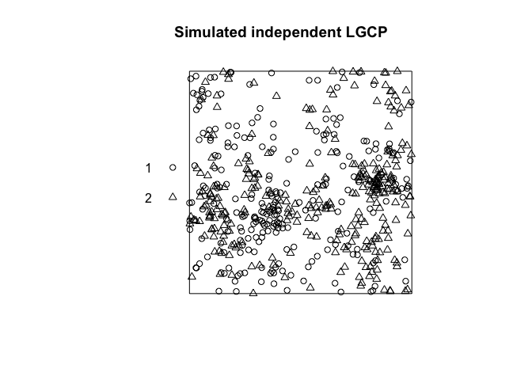
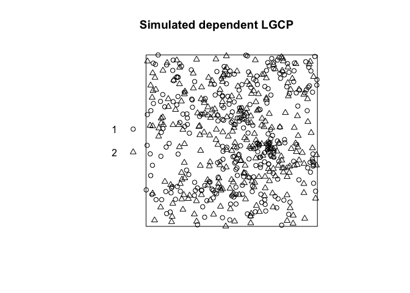

<!-- README.md is generated from README.Rmd. Please edit that file -->

# spatbiome

A collection of functions for spatial analysis of microbiome data.
Currently contains ARShift, a random shift test for bivariate point
patterns.

## Installation

You can install the development version of spatbiome from
[GitHub](https://github.com/) with:

``` r
devtools::install_github("asmita112358/spatbiome")
```

## Generate data

For more data generating functions, please refer to the `datagen.R`
script in the `scripts` folder.

``` r
library(spatbiome)
generate_LGCP <- function(win, corrfun = "exponential",mu = 5, scale = 0.1, dependant = FALSE){

  data1 <- spatstat.random::rLGCP(corrfun, mu = mu, win = win, scale = scale, var = 1)

  if(dependant == FALSE){
    data2 <- spatstat.random::rLGCP(corrfun, mu = mu, win = win, scale = scale, var = 1)
  } else {
    data2 <- data1
    runif_sh <- spatstat.random::runifdisc(data1$n, radius = 0.2)
    data2$x <- data1$x + runif_sh$x
    data2$y <- data1$y + runif_sh$y

    keep <- spatstat.geom::inside.owin(data2$x, data2$y, win)
    data2 <- data2[keep]
  }

  spatstat.geom::marks(data1) <- factor(rep(1, spatstat.geom::npoints(data1)), levels = c(1, 2))
  spatstat.geom::marks(data2) <- factor(rep(2, spatstat.geom::npoints(data2)), levels = c(1, 2))

  data_all <- spatstat.geom::superimpose(data1, data2, W = win)
  spatstat.geom::marks(data_all) <- factor(spatstat.geom::marks(data_all), levels = c(1, 2))

  return(data_all)
}
```

## Example 1. Null hypothesis: independent point patterns

This is a basic example which demonstrates the implementation of ARShift
for two independent Log Gaussian point processes. The null hypothesis is
that the two point patterns are independent.

``` r
X <- generate_LGCP(win = spatstat.geom::owin(c(0, 1), c(0, 1)), corrfun = "exponential", mu = 5, scale = 0.1, dependant = FALSE)
plot(X, main = "Simulated independent LGCP")
```



``` r
res <- ARShift(data = X, i = "1", j = "2", n_perm = 499, workers = 5, type = "hom")
res
#> $pval_Kcross_area
#> [1] 0.486
#> 
#> $K_fun
#>  [1] 0.000000e+00 2.691935e-05 8.075805e-05 2.722890e-04 3.934260e-04
#>  [6] 7.458827e-04 1.145838e-03 1.481291e-03 1.941683e-03 2.427345e-03
#> [11] 3.024348e-03 3.719665e-03 4.448915e-03 5.054776e-03 5.739055e-03
#> [16] 6.657996e-03 7.631482e-03 8.693738e-03 9.719843e-03 1.076804e-02
#> [21] 1.178577e-02 1.313647e-02 1.440203e-02 1.584987e-02 1.727332e-02
#> [26] 1.887563e-02 2.060309e-02 2.252549e-02 2.462361e-02 2.651369e-02
#> [31] 2.835341e-02 3.037673e-02 3.257027e-02 3.456973e-02 3.681591e-02
#> [36] 3.913597e-02 4.163189e-02 4.428749e-02 4.647396e-02 4.917696e-02
#> [41] 5.168731e-02 5.392974e-02 5.680644e-02 6.012836e-02 6.322477e-02
#> [46] 6.621379e-02 6.964718e-02 7.252490e-02 7.566873e-02 7.889148e-02
#> 
#> $n_valid
#> [1] 499
#> 
#> $n_valid_total
#> [1] 549
#> 
#> $n_attempts
#> [1] 549
#> 
#> $k
#> [1] 1.1
#> 
#> $r
#>  [1] 0.000000000 0.003061224 0.006122449 0.009183673 0.012244898 0.015306122
#>  [7] 0.018367347 0.021428571 0.024489796 0.027551020 0.030612245 0.033673469
#> [13] 0.036734694 0.039795918 0.042857143 0.045918367 0.048979592 0.052040816
#> [19] 0.055102041 0.058163265 0.061224490 0.064285714 0.067346939 0.070408163
#> [25] 0.073469388 0.076530612 0.079591837 0.082653061 0.085714286 0.088775510
#> [31] 0.091836735 0.094897959 0.097959184 0.101020408 0.104081633 0.107142857
#> [37] 0.110204082 0.113265306 0.116326531 0.119387755 0.122448980 0.125510204
#> [43] 0.128571429 0.131632653 0.134693878 0.137755102 0.140816327 0.143877551
#> [49] 0.146938776 0.150000000
```

## Example 2. Null hypothesis: dependent point patterns

Here, points of type 2 are placed close to points of type 1 to mimic
association between point types.

``` r
X <- generate_LGCP(win = spatstat.geom::owin(c(0, 1), c(0, 1)), corrfun = "exponential", mu = 5, scale = 0.1, dependant = TRUE)
plot(X, main = "Simulated dependent LGCP")
```



``` r
res <- ARShift(data = X, i = "1", j = "2", n_perm = 499, workers = 5, type = "hom")
res
#> $pval_Kcross_area
#> [1] 0.036
#> 
#> $K_fun
#>  [1] 0.0000000000 0.0000538329 0.0001211240 0.0002826227 0.0004844961
#>  [6] 0.0007267442 0.0011439492 0.0015821028 0.0021917721 0.0027708937
#> [11] 0.0032688481 0.0038559005 0.0046840899 0.0055336547 0.0066778830
#> [16] 0.0077413745 0.0085277951 0.0099426065 0.0109751687 0.0126760877
#> [21] 0.0139354515 0.0153420722 0.0164739631 0.0181130069 0.0195994916
#> [26] 0.0212843451 0.0231217075 0.0246521954 0.0265010353 0.0282751924
#> [31] 0.0306323659 0.0325677486 0.0345536046 0.0364882355 0.0385636303
#> [36] 0.0408405052 0.0432354658 0.0456682637 0.0480866476 0.0508674948
#> [41] 0.0536029860 0.0563951285 0.0588266213 0.0618600667 0.0644004279
#> [46] 0.0673885542 0.0708451909 0.0739841535 0.0775308193 0.0812772004
#> 
#> $n_valid
#> [1] 499
#> 
#> $n_valid_total
#> [1] 549
#> 
#> $n_attempts
#> [1] 549
#> 
#> $k
#> [1] 1.1
#> 
#> $r
#>  [1] 0.000000000 0.003061224 0.006122449 0.009183673 0.012244898 0.015306122
#>  [7] 0.018367347 0.021428571 0.024489796 0.027551020 0.030612245 0.033673469
#> [13] 0.036734694 0.039795918 0.042857143 0.045918367 0.048979592 0.052040816
#> [19] 0.055102041 0.058163265 0.061224490 0.064285714 0.067346939 0.070408163
#> [25] 0.073469388 0.076530612 0.079591837 0.082653061 0.085714286 0.088775510
#> [31] 0.091836735 0.094897959 0.097959184 0.101020408 0.104081633 0.107142857
#> [37] 0.110204082 0.113265306 0.116326531 0.119387755 0.122448980 0.125510204
#> [43] 0.128571429 0.131632653 0.134693878 0.137755102 0.140816327 0.143877551
#> [49] 0.146938776 0.150000000
```
