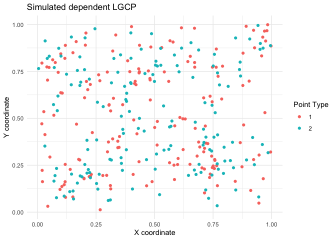

<!-- README.md is generated from README.Rmd. Please edit that file -->

# spatbiome

A collection of functions for spatial analysis of microbiome data.
Currently contains ARShift, a random shift test for bivariate point
patterns.

## Installation

You can install the development version of spatbiome from
[GitHub](https://github.com/) with:

``` r
pak::pak("asmita112358/spatbiome", dependencies = TRUE)
#> ℹ Loading metadata database✔ Loading metadata database ... done
#>  
#> → Package library at '/Library/Frameworks/R.framework/Versions/4.6/Resources/library'.
#> ℹ No downloads are needed
#> ✔ 1 pkg + 40 deps: kept 40 [4.4s]
library(spatbiome)
```

## Data generating functions and simulation scripts

The package includes the data-generating functions in scripts/datagen.R.
To locate this script and the results_in_paper directory in your
installed copy of spatbiome, run

``` r
system.file("results_in_paper", package = "spatbiome")
#> [1] "/Library/Frameworks/R.framework/Versions/4.6/Resources/library/spatbiome/results_in_paper"
system.file("scripts", package = "spatbiome")
#> [1] "/Library/Frameworks/R.framework/Versions/4.6/Resources/library/spatbiome/scripts"
```

These commands return the full paths to the files and directory. Open
datagen.R in RStudio with:

``` r
file.edit(system.file("scripts", "datagen.R", package = "spatbiome"))
```

An example data generating function is provided below. The function
`generate_LGCP` generates two Log Gaussian Cox Processes (LGCPs) in a
specified window. The user can choose to generate independent point
patterns or dependent point patterns where points of type 2 are placed
close to points of type 1.

``` r
generate_LGCP <- function(win, corrfun = "exponential",mu = 5, scale = 0.1, dependant = FALSE){

  data1 <- spatstat.random::rLGCP(corrfun, mu = mu, win = win, scale = scale, var = 1)

  if(dependant == FALSE){
    data2 <- spatstat.random::rLGCP(corrfun, mu = mu, win = win, scale = scale, var = 1)
  } else {
    data2 <- data1
    runif_sh <- spatstat.random::runifdisc(data1$n, radius = 0.1)
    data2$x <- data1$x + runif_sh$x
    data2$y <- data1$y + runif_sh$y

    keep <- spatstat.geom::inside.owin(data2$x, data2$y, win)
    data2 <- data2[keep]
  }

  spatstat.geom::marks(data1) <- factor(rep(1, spatstat.geom::npoints(data1)), levels = c(1, 2))
  spatstat.geom::marks(data2) <- factor(rep(2, spatstat.geom::npoints(data2)), levels = c(1, 2))

  data_all <- spatstat.geom::superimpose(data1, data2, W = win)
  spatstat.geom::marks(data_all) <- factor(spatstat.geom::marks(data_all), levels = c(1, 2))

  return(data_all)
}
```

## Example 1. Null hypothesis: independent point patterns

This is a basic example which demonstrates the implementation of ARShift
for two independent Log Gaussian point processes. The null hypothesis is
that the two point patterns are independent.

``` r
library(ggplot2)
X <- generate_LGCP(win = spatstat.geom::owin(c(0, 1), c(0, 1)), corrfun = "exponential", mu = 5, scale = 0.1, dependant = FALSE)
plot_X <- data.frame(X)
ggplot(plot_X, aes(x = x, y = y, color = marks)) + 
  geom_point() +
  labs(title = "Simulated independent LGCP", x = "X coordinate", y = "Y coordinate", color = "Point Type") +
  theme_minimal()
```


``` r
res <- ARShift(data = X, i = "1", j = "2", n_perm = 499, workers = 5, type = "hom")
res
#> $p
#> [1] 0.064
#> 
#> $K
#>  [1] 0.0000000000 0.0000159261 0.0001044503 0.0002126663 0.0005474595
#>  [6] 0.0008392205 0.0012455341 0.0017376568 0.0024152214 0.0031076744
#> [11] 0.0039132040 0.0047076918 0.0055401279 0.0064732268 0.0076039768
#> [16] 0.0088232471 0.0101573527 0.0114017645 0.0127600617 0.0139524128
#> [21] 0.0155913216 0.0170355028 0.0184654593 0.0200385732 0.0218801525
#> [26] 0.0236577130 0.0255479671 0.0272986315 0.0295592813 0.0312295560
#> [31] 0.0336279516 0.0359726699 0.0380846839 0.0407941511 0.0431222606
#> [36] 0.0456315162 0.0482654838 0.0510284124 0.0538327329 0.0566786660
#> [41] 0.0597316264 0.0632406313 0.0665951906 0.0699399744 0.0727405565
#> [46] 0.0753655078 0.0783685094 0.0812885685 0.0841073352 0.0873375809
#> 
#> $r
#>  [1] 0.000000000 0.003061224 0.006122449 0.009183673 0.012244898 0.015306122
#>  [7] 0.018367347 0.021428571 0.024489796 0.027551020 0.030612245 0.033673469
#> [13] 0.036734694 0.039795918 0.042857143 0.045918367 0.048979592 0.052040816
#> [19] 0.055102041 0.058163265 0.061224490 0.064285714 0.067346939 0.070408163
#> [25] 0.073469388 0.076530612 0.079591837 0.082653061 0.085714286 0.088775510
#> [31] 0.091836735 0.094897959 0.097959184 0.101020408 0.104081633 0.107142857
#> [37] 0.110204082 0.113265306 0.116326531 0.119387755 0.122448980 0.125510204
#> [43] 0.128571429 0.131632653 0.134693878 0.137755102 0.140816327 0.143877551
#> [49] 0.146938776 0.150000000
#> 
#> $n_attempts
#> [1] 549
#> 
#> $n_valid
#> [1] 549
#> 
#> $n_perm
#> [1] 499
```

## Example 2. Alternative hypothesis: co-clustering point patterns

Here, points of type 2 are placed close to points of type 1 to mimic
association between point types.

``` r
X <- generate_LGCP(win = spatstat.geom::owin(c(0, 1), c(0, 1)), corrfun = "exponential", mu = 5, scale = 0.1, dependant = TRUE)
plot_X <- data.frame(X)
ggplot(plot_X, aes(x = x, y = y, color = marks)) + 
  geom_point() +
  labs(title = "Simulated dependent LGCP", x = "X coordinate", y = "Y coordinate", color = "Point Type") +
  theme_minimal()
```



``` r
res <- ARShift(data = X, i = "1", j = "2", n_perm = 499, workers = 5, type = "hom")
res
#> $p
#> [1] 0.002
#> 
#> $K
#>  [1] 0.000000e+00 4.995917e-05 8.861100e-05 2.818701e-04 5.764335e-04
#>  [6] 6.923889e-04 1.156211e-03 1.813292e-03 2.547677e-03 3.362719e-03
#> [11] 4.019800e-03 5.136412e-03 6.061124e-03 7.003695e-03 8.233458e-03
#> [16] 9.400235e-03 1.086138e-02 1.222129e-02 1.318738e-02 1.449857e-02
#> [21] 1.674631e-02 1.856965e-02 2.033071e-02 2.228935e-02 2.394582e-02
#> [26] 2.614036e-02 2.842925e-02 3.061006e-02 3.314198e-02 3.516171e-02
#> [31] 3.738055e-02 3.941558e-02 4.212948e-02 4.446619e-02 4.678825e-02
#> [36] 4.909844e-02 5.159548e-02 5.340454e-02 5.561690e-02 5.811597e-02
#> [41] 6.096367e-02 6.370549e-02 6.640453e-02 7.008582e-02 7.328965e-02
#> [46] 7.616112e-02 7.928366e-02 8.234104e-02 8.571477e-02 8.833558e-02
#> 
#> $r
#>  [1] 0.000000000 0.003061224 0.006122449 0.009183673 0.012244898 0.015306122
#>  [7] 0.018367347 0.021428571 0.024489796 0.027551020 0.030612245 0.033673469
#> [13] 0.036734694 0.039795918 0.042857143 0.045918367 0.048979592 0.052040816
#> [19] 0.055102041 0.058163265 0.061224490 0.064285714 0.067346939 0.070408163
#> [25] 0.073469388 0.076530612 0.079591837 0.082653061 0.085714286 0.088775510
#> [31] 0.091836735 0.094897959 0.097959184 0.101020408 0.104081633 0.107142857
#> [37] 0.110204082 0.113265306 0.116326531 0.119387755 0.122448980 0.125510204
#> [43] 0.128571429 0.131632653 0.134693878 0.137755102 0.140816327 0.143877551
#> [49] 0.146938776 0.150000000
#> 
#> $n_attempts
#> [1] 549
#> 
#> $n_valid
#> [1] 549
#> 
#> $n_perm
#> [1] 499
```
