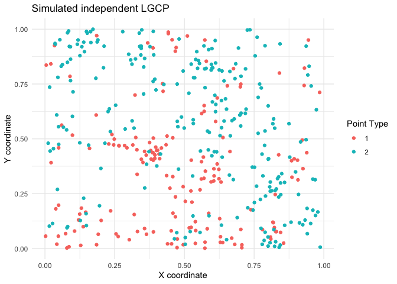
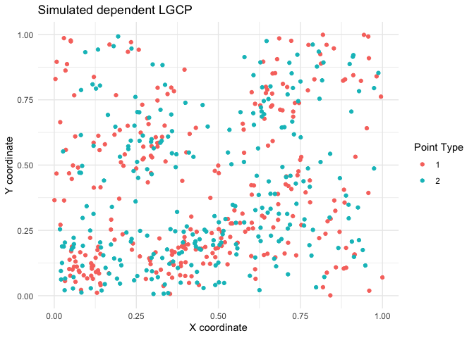

<!-- README.md is generated from README.Rmd. Please edit that file -->

# spatbiome

A collection of functions for spatial analysis of microbiome data.
Currently contains ARShift, a random shift test for bivariate point
patterns.

## Installation

You can install the development version of spatbiome from
[GitHub](https://github.com/) with:

``` r

# Install a package from GitHub
pak::pak("asmita112358/spatbiome")
#> ℹ Loading metadata database✔ Loading metadata database ... done
#>  
#> → Package library at '/Library/Frameworks/R.framework/Versions/4.6/Resources/library'.
#> ℹ No downloads are needed
#> ✔ 1 pkg + 40 deps: kept 40 [4.5s]
```

## Generate data

For more data generating functions, please refer to the `datagen.R`
script in the `scripts` folder.

``` r
library(spatbiome)
generate_LGCP <- function(win, corrfun = "exponential",mu = 5, scale = 0.1, dependant = FALSE){

  data1 <- spatstat.random::rLGCP(corrfun, mu = mu, win = win, scale = scale, var = 1)

  if(dependant == FALSE){
    data2 <- spatstat.random::rLGCP(corrfun, mu = mu, win = win, scale = scale, var = 1)
  } else {
    data2 <- data1
    runif_sh <- spatstat.random::runifdisc(data1$n, radius = 0.1)
    data2$x <- data1$x + runif_sh$x
    data2$y <- data1$y + runif_sh$y

    keep <- spatstat.geom::inside.owin(data2$x, data2$y, win)
    data2 <- data2[keep]
  }

  spatstat.geom::marks(data1) <- factor(rep(1, spatstat.geom::npoints(data1)), levels = c(1, 2))
  spatstat.geom::marks(data2) <- factor(rep(2, spatstat.geom::npoints(data2)), levels = c(1, 2))

  data_all <- spatstat.geom::superimpose(data1, data2, W = win)
  spatstat.geom::marks(data_all) <- factor(spatstat.geom::marks(data_all), levels = c(1, 2))

  return(data_all)
}
```

## Example 1. Null hypothesis: independent point patterns

This is a basic example which demonstrates the implementation of ARShift
for two independent Log Gaussian point processes. The null hypothesis is
that the two point patterns are independent.

``` r
library(ggplot2)
X <- generate_LGCP(win = spatstat.geom::owin(c(0, 1), c(0, 1)), corrfun = "exponential", mu = 5, scale = 0.1, dependant = FALSE)
plot_X <- data.frame(X)
ggplot(plot_X, aes(x = x, y = y, color = marks)) + 
  geom_point() +
  labs(title = "Simulated independent LGCP", x = "X coordinate", y = "Y coordinate", color = "Point Type") +
  theme_minimal()
```



``` r
res <- ARShift(data = X, i = "1", j = "2", n_perm = 499, workers = 5, type = "hom")
res
#> $p
#> [1] 0.694
#> 
#> $K
#>  [1] 0.000000e+00 0.000000e+00 4.773839e-05 2.386920e-04 4.296455e-04
#>  [6] 7.638143e-04 1.050245e-03 1.432152e-03 1.599236e-03 2.178905e-03
#> [11] 2.804990e-03 3.425377e-03 4.128397e-03 4.885784e-03 5.718792e-03
#> [16] 6.414215e-03 7.083354e-03 7.831378e-03 9.117970e-03 1.029195e-02
#> [21] 1.129907e-02 1.222730e-02 1.309367e-02 1.406929e-02 1.548456e-02
#> [26] 1.639096e-02 1.755519e-02 1.892392e-02 2.034838e-02 2.184529e-02
#> [31] 2.321219e-02 2.505392e-02 2.693658e-02 2.841749e-02 3.016747e-02
#> [36] 3.190022e-02 3.366787e-02 3.559592e-02 3.741598e-02 3.956300e-02
#> [41] 4.128973e-02 4.372040e-02 4.551378e-02 4.822375e-02 5.061581e-02
#> [46] 5.246450e-02 5.426285e-02 5.668629e-02 5.856923e-02 6.090046e-02
#> 
#> $r
#>  [1] 0.000000000 0.003061224 0.006122449 0.009183673 0.012244898 0.015306122
#>  [7] 0.018367347 0.021428571 0.024489796 0.027551020 0.030612245 0.033673469
#> [13] 0.036734694 0.039795918 0.042857143 0.045918367 0.048979592 0.052040816
#> [19] 0.055102041 0.058163265 0.061224490 0.064285714 0.067346939 0.070408163
#> [25] 0.073469388 0.076530612 0.079591837 0.082653061 0.085714286 0.088775510
#> [31] 0.091836735 0.094897959 0.097959184 0.101020408 0.104081633 0.107142857
#> [37] 0.110204082 0.113265306 0.116326531 0.119387755 0.122448980 0.125510204
#> [43] 0.128571429 0.131632653 0.134693878 0.137755102 0.140816327 0.143877551
#> [49] 0.146938776 0.150000000
#> 
#> $n_attempts
#> [1] 549
#> 
#> $n_valid
#> [1] 549
#> 
#> $n_perm
#> [1] 499
```

## Example 2. Alternative hypothesis: co-clustering point patterns

Here, points of type 2 are placed close to points of type 1 to mimic
association between point types.

``` r
X <- generate_LGCP(win = spatstat.geom::owin(c(0, 1), c(0, 1)), corrfun = "exponential", mu = 5, scale = 0.1, dependant = TRUE)
plot_X <- data.frame(X)
ggplot(plot_X, aes(x = x, y = y, color = marks)) + 
  geom_point() +
  labs(title = "Simulated dependent LGCP", x = "X coordinate", y = "Y coordinate", color = "Point Type") +
  theme_minimal()
```



``` r
res <- ARShift(data = X, i = "1", j = "2", n_perm = 499, workers = 5, type = "hom")
res
#> $p
#> [1] 0.002
#> 
#> $K
#>  [1] 0.000000e+00 2.749859e-05 1.099944e-04 4.399775e-04 7.974591e-04
#>  [6] 1.196189e-03 1.696169e-03 2.240969e-03 2.873437e-03 3.694999e-03
#> [11] 4.689403e-03 5.569358e-03 6.753665e-03 8.029231e-03 9.257832e-03
#> [16] 1.047336e-02 1.203045e-02 1.349970e-02 1.501302e-02 1.651756e-02
#> [21] 1.831668e-02 2.005608e-02 2.236820e-02 2.451408e-02 2.653917e-02
#> [26] 2.861694e-02 3.120772e-02 3.380867e-02 3.635325e-02 3.890814e-02
#> [31] 4.177188e-02 4.467765e-02 4.754626e-02 5.043737e-02 5.314497e-02
#> [36] 5.600311e-02 5.882405e-02 6.182120e-02 6.467815e-02 6.787635e-02
#> [41] 7.140149e-02 7.431836e-02 7.763620e-02 8.095423e-02 8.445795e-02
#> [46] 8.732106e-02 9.076588e-02 9.423711e-02 9.739393e-02 1.008919e-01
#> 
#> $r
#>  [1] 0.000000000 0.003061224 0.006122449 0.009183673 0.012244898 0.015306122
#>  [7] 0.018367347 0.021428571 0.024489796 0.027551020 0.030612245 0.033673469
#> [13] 0.036734694 0.039795918 0.042857143 0.045918367 0.048979592 0.052040816
#> [19] 0.055102041 0.058163265 0.061224490 0.064285714 0.067346939 0.070408163
#> [25] 0.073469388 0.076530612 0.079591837 0.082653061 0.085714286 0.088775510
#> [31] 0.091836735 0.094897959 0.097959184 0.101020408 0.104081633 0.107142857
#> [37] 0.110204082 0.113265306 0.116326531 0.119387755 0.122448980 0.125510204
#> [43] 0.128571429 0.131632653 0.134693878 0.137755102 0.140816327 0.143877551
#> [49] 0.146938776 0.150000000
#> 
#> $n_attempts
#> [1] 549
#> 
#> $n_valid
#> [1] 549
#> 
#> $n_perm
#> [1] 499
```
